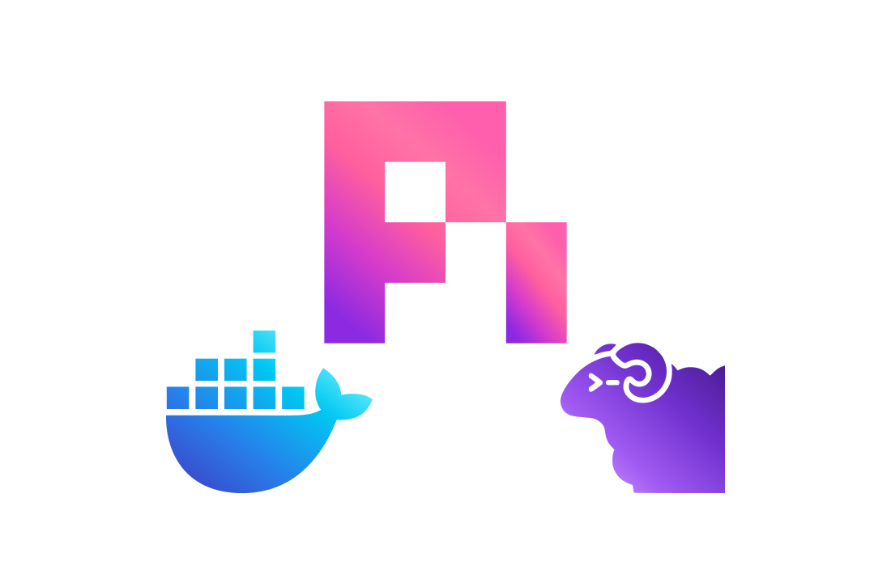

<p align="center">
  
</p>

# Pi + Docker + Herdr

Love Pi in Herdr — spawning new instances in separate panes,
detaching without stopping work? But also hate a swarm of agents
running loose on your system with your user privileges?

pi-docker gives each Pi instance its own Docker container. Pi runs
as you — but only inside the container. Your system is out of reach
except for the project and the shared configuration you mount in.
Customize the image to fit your workflow: tools, skills, extensions,
system prompts.

Runs on any Linux system with Docker Engine and Compose; Herdr
integration is optional. Pi does not even need to be installed on
the host.

## Quick start

From this repository, on the host:

```bash
./bin/build          # base image
# ./bin/build custom # optional development image; requires base
mkdir -p ~/.local/bin
ln -sfn "$(pwd)/bin/pi" ~/.local/bin/pi
# Ensure ~/.local/bin is on PATH, then choose an existing project:
pi ~/repos/project
```

Inside Pi, use `/login` and `/model`.

Without `--image` or `PI_DOCKER_IMAGE`, the launcher prefers a local
`pi-docker:custom` over `pi-docker:base`: the minimal base, and the
derived image that shows how to extend it. See [usage](docs/USAGE.md#launching)
and [image customization](docs/CUSTOMIZATION.md#two-images).

**Security:** This is not a hardened sandbox. Containers can write the project
and read mounted credentials; networking is shared with the host. Launches
inside a Herdr session gain control of the whole connected session.
Use `--no-herdr` to disable integration. Read [setup and security](docs/SETUP.md).

## Guides

- [Setup](docs/SETUP.md): requirements, installation, mounts, security.
- [Usage](docs/USAGE.md): launcher options and conversations.
- [Authentication](docs/AUTHENTICATION.md): providers and GitHub credentials.
- [Herdr](docs/HERDR_INTEGRATION.md): helpers, restore, diagnostics.
- [Customization](docs/CUSTOMIZATION.md): images, resources, updates.
- [Container instructions](docs/AGENTS.md): compact agent orientation.

Guide commands run on the host from this repository root unless marked otherwise.

## Repository

Host tooling lives in `bin/` and `lib/`, build recipes in `images/`, and shared
resources in `extensions/` and `skills/`. Builds use only `images/`; containers
mount allowlisted deployment paths at `/opt/pi-docker`, not the repository root.
Private state lives in ignored `data/`: **back it up privately; never publish it.**

## Tests

Test offline with Python 3 (and Node.js for the adapter tests); no
Docker or Herdr is needed:

```bash
python3 -m unittest discover -s tests -p 'test_*.py'
```

Adapter tests skip without Node.js. Neither runtime is needed on the host to launch Pi.

Licensed under the MIT License; see `LICENSE`.
